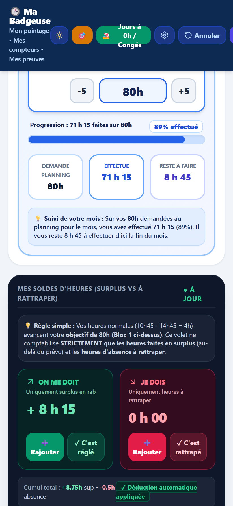
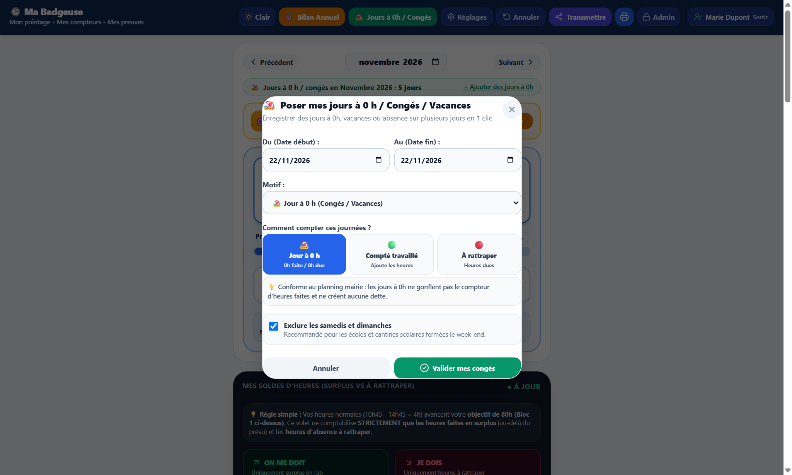

# Suivi Heures Pro 🕒 (Ma Badgeuse)
**Application web mobile-first (PWA) de suivi des heures de travail à planning variable**  
*Conçue spécifiquement pour le personnel de cantine scolaire, d'entretien des locaux et de garderie.*

---

## 📸 Aperçu de l'Application (Captures d'écran)

### 📱 Expérience Mobile (PWA Smartphone)

| 1. Cockpit & Soldes Nets | 2. Saisie Rapide du Pointage | 3. Historique & Livre de Preuves |
| :---: | :---: | :---: |
|  |  |  |
| *Vignette Phare : Heures sup nettes (+8h15) et dette éteinte (0h00)* | *Horaires habituels pré-remplis (10h45 - 14h45), pauses et statuts* | *Tableau chronologique complet avec pastilles colorées et motifs* |

<br/>

| 4. Bilan Annuel Scolaire (Septembre à Août) | 5. Poser des Périodes Multi-Jours |
| :---: | :---: |
|  |  |
| *Décompte en temps réel sur le quota annuel contractuel (800h)* | *Congés, vacances scolaires, arrêts sans répéter la saisie* |

---

### 💻 Version Grand Écran (Ordinateur & Tablette)

<div align="center">
  
  <p><em>Vue complète du tableau de bord sur grand écran avec accès aux réglages, transmission et export officiel.</em></p>
</div>

---

## 🌟 Points Forts & Philosophie de l'Application

- 📱 **Mobile-First & PWA Réelle :** Conçue pour une utilisation ultra-rapide sur smartphone Android et iPhone. S'installe directement sur l'écran d'accueil avec de vraies icônes d'application natives haute définition (`192x192` et `512x512`).
- ⚖️ **Compensation Directe & Logique (Rattrapage automatique) :**
  - **Heures supplémentaires :** Dues par l'employeur (à payer ou récupérer).
  - **Heures à rattraper :** Dues à l'employeur.
  - **Rattrapage automatique :** Vos heures supplémentaires viennent directement et intelligemment combler vos absences éventuelles (dette éteinte à 0h00 si couverte).
  - **Persistance infinie :** Vos soldes restent visibles mois après mois et année après année sans remise à zéro arbitraire.
- 👥 **Multi-Utilisateurs & Espaces Étanche :**
  - Gestion sécurisée de plusieurs comptes indépendants (ex. les membres de la famille).
  - **Remise à zéro personnelle (RAZ) 100% isolée :** Réinitialise vos propres heures sans jamais impacter les données des autres comptes. Sauvegarde d'urgence (`safety_user_X`) créée automatiquement avant tout effacement.
- 🔐 **Sécurité & Mode Administrateur Renforcés :**
  - Mots de passe hachés avec **PBKDF2 salé** (10 000 itérations SHA-256) et protection anti-force brute (verrouillage 15 min après 5 échecs).
  - **Mode Administrateur protégé par code PIN :** Verrouillage strict des opérations sensibles (sauvegardes serveur, restauration globale, suppression d'utilisateur).
- 🎯 **3 Niveaux Horaires :** Objectif contractuel fixe, heures attendues au planning jour par jour (4h00 par défaut de 10h45 à 14h45), et heures réellement effectuées.
- 🎨 **Palette de 9 Statuts Métier :** Congés payés, journées à 0h, arrêts maladie, événements familiaux, congés maternité, congés sans solde, vacances scolaires, fermetures d'école, jours fériés — pilotant directement le calcul comptable (`MAINTAINED`, `NEUTRAL`, `DEDUCTED`).
- 🖨️ **Feuille d'Émargement Officielle :** Format d'impression A4 prêt pour la paie et la direction avec double cadre de visa et signature réglementaire (Code du Travail Art. L. 3171-4).
- 🛡️ **Protection Anti-Écrasement :** Les modifications apportées à un jour précis priment toujours sur les périodes collectives ; une alerte obligatoire vous avertit avant tout écrasement.
- 🏠 **Auto-Hébergement Souverain :** Déploiement léger et autonome sous Docker sur votre serveur Proxmox (LXC ou VM) avec base de données SQLite en mode WAL.

---

## 🏗️ Architecture Technique

```
┌────────────────────────────────────────────────────────┐
│                   Smartphone / PWA                     │
│  React 18 + TypeScript + Tailwind CSS + Lucide Icons   │
│       (PWA Standalone, Service Worker, Icônes HD)      │
└───────────────────────────▲────────────────────────────┘
                            │ REST API (JSON + JWT/Bearer + PIN)
┌───────────────────────────▼────────────────────────────┐
│              Conteneur Docker Node.js                  │
│       Express + TypeScript + SQLite3 (Mode WAL)        │
│       Moteur de calcul compensé + Auth PBKDF2 salé     │
└───────────────────────────▲────────────────────────────┘
                            │ WAL Mode
┌───────────────────────────▼────────────────────────────┐
│                    Volumes Proxmox                     │
│        ./data/database.sqlite (Données actives)        │
│        ./backups/             (Sauvegardes à chaud)    │
└────────────────────────────────────────────────────────┘
```

### Stack Applicative
- **Frontend :** React 18, TypeScript, Tailwind CSS, Vite, `vite-plugin-pwa`, Lucide React.
- **Backend :** Node.js 20 LTS, Express, TypeScript, SQLite3 natif.
- **Base de Données :** SQLite 3 configuré pour la haute résilience :
  - `PRAGMA journal_mode = WAL;` (Write-Ahead Logging pour des lectures et écritures concurrentes non-bloquantes).
  - `PRAGMA synchronous = NORMAL;` (Résilience contre les coupures).
  - `PRAGMA foreign_keys = ON;`
- **Sauvegarde à chaud :** Commande native `VACUUM INTO` sans interruption de service.

---

## 🚀 Déploiement sous Proxmox (Docker Compose)

### 1. Structure Recommandée sur le Serveur

```bash
/opt/suivi-heures-pro/
├── docker-compose.yml
├── data/       # Stockage persistant de la base SQLite
└── backups/    # Répertoire des sauvegardes automatiques
```

### 2. Démarrage Rapide

```bash
cd /opt/suivi-heures-pro
docker compose up -d --build
```

L'application est immédiatement accessible sur `http://IP_SERVEUR:3000`.

---

## 💾 Sauvegardes & Sécurité des Données

1. **Sauvegarde Manuelle & Export :** Téléchargez une copie directe de votre base de données au format `.sqlite` en 1 clic depuis l'onglet *Maintenance & Serveur*.
2. **Sauvegardes d'Urgence (`safety_`) :** Avant toute opération critique (remise à zéro personnelle, restauration d'un fichier), une copie d'urgence non purgeable est archivée sur le serveur.
3. **Rotation Automatique :** Le système conserve 14 sauvegardes de routine tout en protégeant définitivement les copies de sécurité.

---

## 🛠️ Commandes Administrateur

| Commande | Action |
| :--- | :--- |
| `docker compose ps` | Vérifier l'état du conteneur et du healthcheck |
| `docker compose logs -f` | Consulter les journaux en temps réel |
| `docker compose restart` | Redémarrer l'application |
| `docker compose down` | Arrêter proprement le service |
