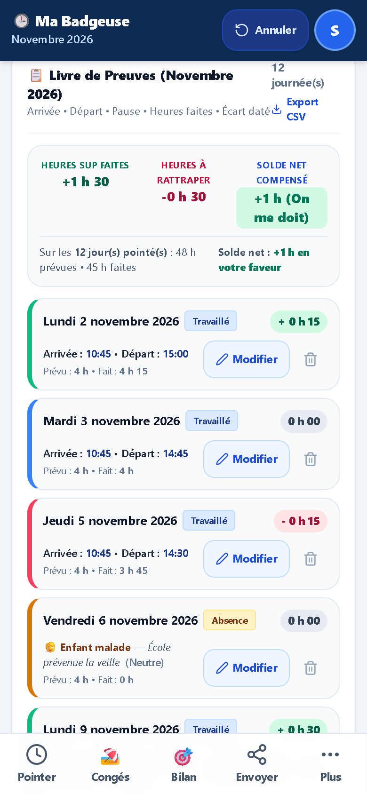
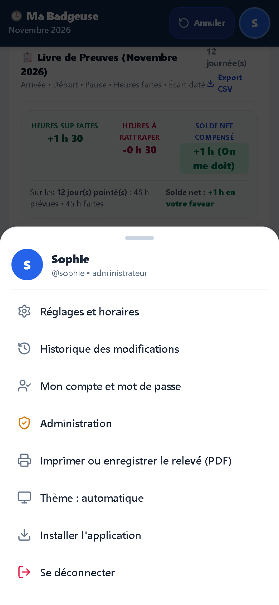

# Ma Badgeuse 🕒
**Application web mobile de suivi des heures de travail à planning variable**
*Pensée pour le personnel de cantine scolaire, d'entretien des locaux et de garderie, avec un contrat annualisé.*

Version actuelle : **0.3.0** (voir [CHANGELOG.md](CHANGELOG.md)).

---

## 📸 Aperçu

Captures de la version 0.3.0 sur téléphone (données de démonstration).

| 1. Accueil et compteurs | 2. Pointage du jour | 3. Livre de preuves |
| :---: | :---: | :---: |
|  |  |  |

| 4. Bilan annuel (septembre à août) | 5. Congés sur plusieurs jours | 6. Menu « Plus » |
| :---: | :---: | :---: |
|  |  |  |

| 7. Installation sur Android |
| :---: |
|  |

Guides en PDF : [guide utilisateur](docs/GUIDE_UTILISATEUR.pdf) • [guide d'installation](docs/GUIDE_INSTALLATION_ET_GESTION_DOCKER.pdf).

---

## 🌟 Fonctionnalités

- 📱 **Conçue pour le téléphone** (usage exclusif) : barre de navigation en bas à portée de pouce, menu « Plus », PWA installable avec fenêtre d'installation sur Android (en un geste en HTTPS), qui n'est plus proposée une fois l'application installée. Pas de mode hors ligne.
- ⚖️ **Deux compteurs clairs** : « On me doit » (heures en plus) et « Je dois » (heures à rattraper), compensés automatiquement, conservés d'un mois sur l'autre.
- 🎯 **Trois niveaux d'heures** : objectif du mois (planning), heures prévues par jour, heures réellement faites ; quota annuel de septembre à août.
- 🏖️ **Absences et périodes** : motifs (congés, maladie, férié, fermeture…) avec impact choisi (neutre, à rattraper, compté travaillé), périodes multi-jours sans écraser les journées saisies à la main.
- 🔒 **Validation du mois** : un mois validé est verrouillé (journées, périodes, régularisations, objectif) jusqu'à sa réouverture.
- ↩️ **Historique et annulation** : chaque modification est journalisée ; « Annuler » revient sur la dernière, l'onglet *Historique* liste les 100 dernières.
- 🖨️ **Relevés imprimables** (mois et année) avec cadres de visa, **export CSV** (Excel), **transmission** par WhatsApp, e-mail, SMS ou copie.
- 👥 **Plusieurs comptes** sur un même serveur, données séparées ; effacement de ses propres données avec sauvegarde de sécurité préalable.
- 🛠️ **Administration** (comptes administrateurs) : sauvegardes, restauration vérifiée, optimisation, gestion des comptes et des mots de passe temporaires.

## 🔐 Sécurité

- **Premier lancement** : aucun compte par défaut. Le premier compte créé devient **administrateur** ; l'inscription libre est ensuite **fermée** (l'administrateur crée les comptes ou rouvre l'inscription).
- **Session** dans un cookie `HttpOnly` / `SameSite=Strict` (jamais lisible par JavaScript), 30 jours glissants, jetons stockés hachés côté serveur.
- **Mots de passe** : 10 caractères minimum, hachage **scrypt** ; anciens hachages convertis à la connexion. Limitation des essais par compte et par adresse IP.
- **Mot de passe oublié** : l'administrateur génère un mot de passe temporaire (à changer à la connexion), ou en ligne de commande sur le serveur :
  ```bash
  docker exec -it ma-badgeuse node backend/dist/scripts/resetPassword.js <identifiant> [--admin]
  ```
- **En-têtes de sécurité** (CSP, anti-cadre, nosniff), vérification de l'origine des requêtes d'écriture, conteneur sans privilèges (utilisateur `node`, système de fichiers en lecture seule).
- **HTTPS recommandé** dès que l'application sort du réseau local : voir le [guide d'installation](docs/GUIDE_INSTALLATION_ET_GESTION_DOCKER.md#accès-en-https).

---

## 🏗️ Architecture

```
┌──────────────────────────────────────────────┐
│ Navigateur (smartphone / ordinateur)         │
│ React 18 + TypeScript + Tailwind + Lucide    │
└──────────────────────▲───────────────────────┘
                       │ API REST JSON + cookie de session
┌──────────────────────▼───────────────────────┐
│ Conteneur Docker Node.js 24                  │
│ Express 4 + TypeScript + sqlite3 (WAL)       │
│ Migrations versionnées (PRAGMA user_version) │
└──────────────────────▲───────────────────────┘
┌──────────────────────▼───────────────────────┐
│ Volumes : ./data (base) • ./backups          │
└──────────────────────────────────────────────┘
```

- **Frontend** : React 18, TypeScript strict, Vite 6, Tailwind CSS 3.
- **Backend** : Node.js ≥ 20.17 (image Docker : Node 24), Express 4, sqlite3 6, multer 2. Une seule connexion SQLite, opérations sérialisées, transactions pour toute écriture multiple.
- **Sauvegardes** : `VACUUM INTO` à chaud, une par jour (14 gardées), sauvegardes de sécurité (20 gardées) avant restauration ou effacement, fichiers vérifiés (`integrity_check`) avant restauration.

---

## 🚀 Installation (Docker Compose)

Le script [gestion-ma-badgeuse.sh](gestion-ma-badgeuse.sh) installe, met à jour (avec sauvegarde préalable) et redémarre l'application. Le détail est dans le [guide d'installation](docs/GUIDE_INSTALLATION_ET_GESTION_DOCKER.md).

```bash
cd /opt/ma-badgeuse
cp .env.example .env          # puis adapter
sudo chown -R 1000:1000 data backups
docker compose up -d --build
```

Ouvrez ensuite `http://IP_DU_SERVEUR:3000` et créez le compte administrateur.

## 🧑‍💻 Développement

```bash
npm run install:all
npm run dev:backend      # API sur http://localhost:3000
npm run dev:frontend     # interface sur http://localhost:5173 (proxy /api)
npm test                 # tests du backend (node:test)
npm run typecheck        # vérification TypeScript backend + frontend
```

## 🛠️ Commandes utiles

| Commande | Action |
| :--- | :--- |
| `docker compose ps` | État du conteneur et du contrôle de santé |
| `docker compose logs -f` | Journaux en temps réel |
| `docker compose restart` | Redémarrer l'application |
| `docker compose down` | Arrêter le service |
