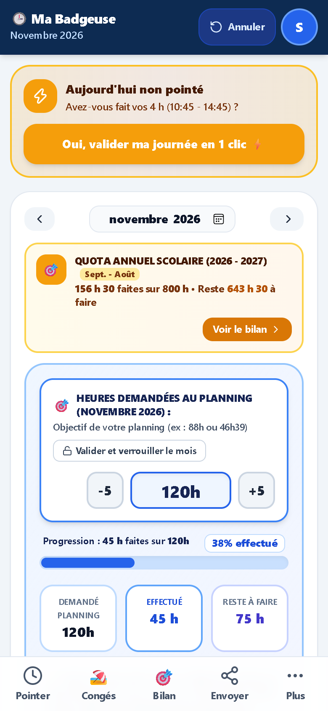
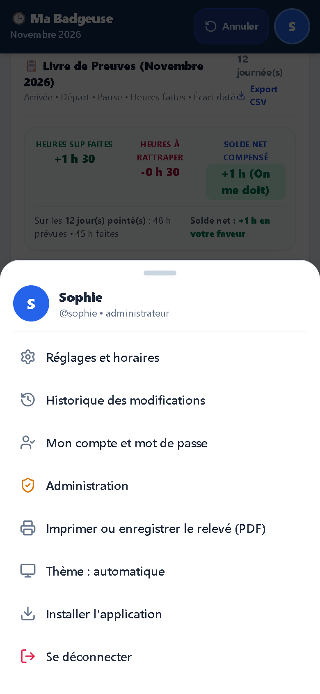
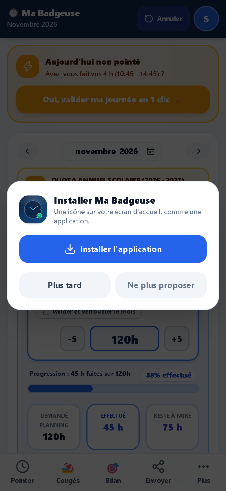
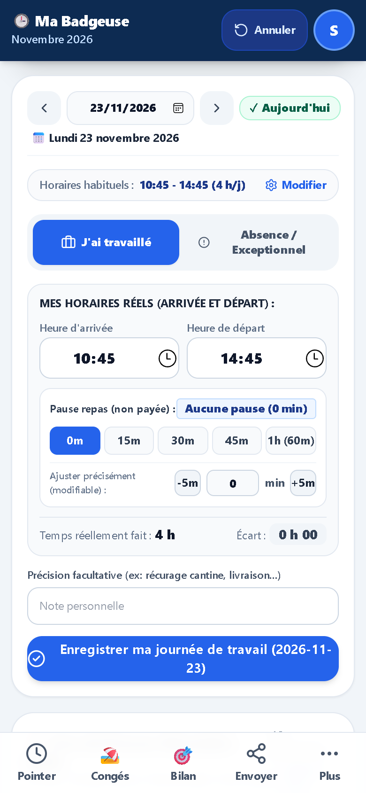
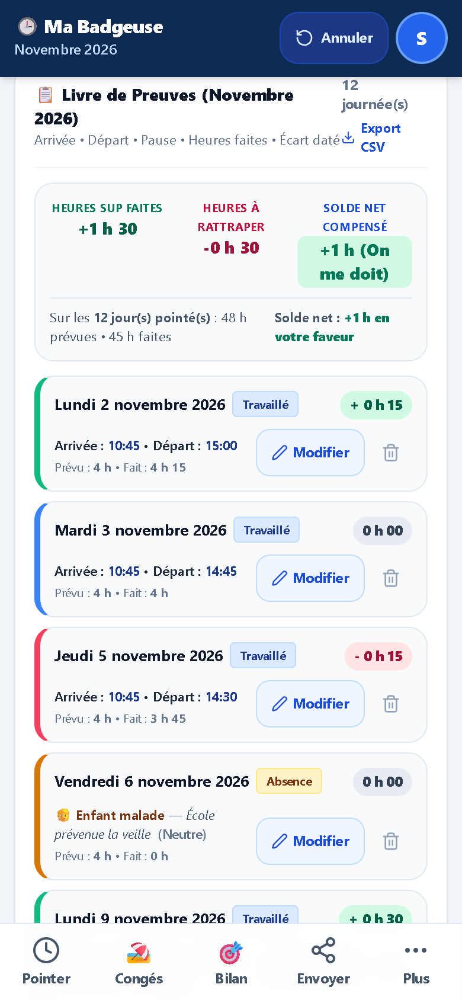
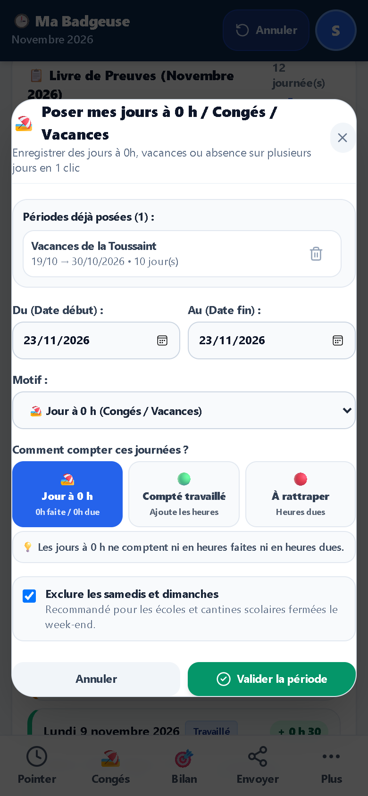
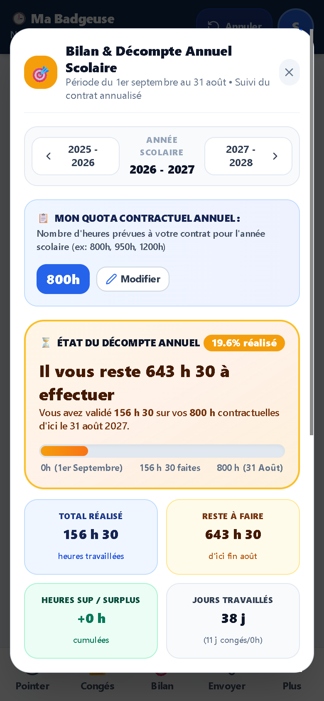

# Guide utilisateur (USER_GUIDE.md)
**Application :** Ma Badgeuse (version 0.3.0)  
**Pour qui ?** Personnel de cantine scolaire, d'entretien des locaux et de garderie.  
**Sur quoi ?** Téléphone (Android, iPhone) : l'application est conçue pour être utilisée au doigt.

---

## 👋 Bienvenue

L'application calcule vos heures à votre place : vous indiquez quand vous arrivez et quand vous partez, elle tient vos compteurs.

---

## 🔑 1. Se connecter

- **Tout premier lancement** : l'écran propose de créer le **compte administrateur**. C'est le compte de la personne qui gère le serveur.
- **Ensuite** : chaque personne reçoit un compte créé par l'administrateur (*Réglages → Administration → Comptes*), avec un mot de passe provisoire à changer à la première connexion.
- **Mot de passe** : 10 caractères minimum. Pour le changer : *Réglages → Mon compte*.
- **Mot de passe oublié** : demandez à l'administrateur de vous donner un mot de passe temporaire.
- **Déconnexion** : touchez la pastille avec votre initiale en haut à droite (ou **Plus**), puis **Se déconnecter**.

### Se repérer
- **En haut** : le mois affiché, le bouton **Annuler** et votre pastille de compte.
- **En bas**, à portée de pouce : **Pointer** (formulaire du jour), **Congés**, **Bilan** (bilan annuel), **Envoyer** (transmettre le récapitulatif) et **Plus** (réglages, historique, mon compte, impression, thème, installation, administration, déconnexion).

<p class="shots" align="center">
  
  
</p>

---

## 📲 2. Installer l'application sur le téléphone

### Android (Chrome)
À la première ouverture, une fenêtre **« Installer Ma Badgeuse »** s'affiche :
- si le bouton **Installer l'application** est présent, touchez-le : l'icône arrive sur l'écran d'accueil ;
- sinon (accès sans HTTPS), suivez les 3 étapes affichées : **3 points** en haut à droite → **« Installer l'application »** ou **« Ajouter à l'écran d'accueil »** → **Ajouter**, puis touchez **C'est fait**.

<p class="shots" align="center">
  
</p>

Une fois installée (ou après **Ne plus proposer**), la fenêtre ne revient plus. **Plus tard** la reporte à la prochaine ouverture. Vous la retrouvez à tout moment dans **Plus → Installer l'application**.

### iPhone (Safari)
1. Ouvrez l'adresse de l'application dans **Safari**.
2. Touchez **Partager** (carré avec une flèche), puis **« Sur l'écran d'accueil »** et **« Ajouter »**.

> L'icône ouvre l'application en plein écran. Une connexion au serveur reste nécessaire (pas de mode hors ligne).

---

## ⏱️ 3. Pointer sa journée

1. Vos **horaires habituels** sont pré-remplis (par défaut 10:45 - 14:45, 4 h, sans pause).
2. Si votre journée a été différente, changez l'heure d'arrivée, de départ ou la pause : l'écart s'affiche aussitôt (ex. départ à 15:15 → **+0 h 30**).
3. Touchez **Enregistrer ma journée**.
4. Les jours de semaine, un bandeau **« Aujourd'hui non pointé »** permet d'enregistrer vos horaires habituels en un geste (**Oui, valider ma journée en 1 clic**).

<p class="shots" align="center">
  
  
</p>

**Changer vos horaires habituels** : bouton **Modifier** à côté des horaires, ou *Plus → Réglages et horaires*. Vous pouvez y indiquer aussi votre nom, votre employeur et votre poste (affichés sur les relevés imprimés).

---

## 🏖️ 4. Absences, congés et périodes

- Pour un jour d'absence : **Absence / Exceptionnel**, choisissez le **motif**, puis comment la journée compte :
  - 🟢 **Validé au mois** : les heures comptent comme travaillées ;
  - 🔴 **À rattraper** : les heures s'ajoutent à « Je dois » ;
  - ⚪ **Neutre** : rien ne change.
- Pour plusieurs jours (vacances, arrêt) : **Congés** dans la barre du bas. Les journées que vous aviez saisies à la main ne sont pas écrasées. La même fenêtre liste les périodes déjà posées et permet de les supprimer.

<p class="shots" align="center">
  
  
</p>

---

## ⚖️ 5. Comprendre vos deux compteurs

```
┌───────────────────────────┬───────────────────────────┐
│        ON ME DOIT         │          JE DOIS          │
│   heures faites en plus   │   heures à rattraper      │
│        + 2 h 00           │          0 h 00           │
└───────────────────────────┴───────────────────────────┘
```

- Vos heures en plus **effacent d'abord** vos heures à rattraper. Ex. : 4 h à rattraper puis 6 h en plus → **Je dois 0 h**, **On me doit +2 h**.
- **Rajouter** : pour reporter un ancien solde.
- **C'est réglé / C'est rattrapé** : quand l'employeur a payé ou que vous avez récupéré des heures (pas plus que le solde affiché, pas à une date future).
- Les compteurs ne sont jamais remis à zéro à la fin du mois.

---

## ✅ 6. Valider un mois

Quand un mois est terminé et vérifié, touchez **Valider et verrouiller le mois** (encart de l'objectif du mois). Plus rien ne peut être modifié sur ce mois (journées, périodes, règlements, objectif) tant que vous ne l'avez pas **rouvert** avec le même bouton.

---

## ↩️ 7. Annuler une erreur, voir l'historique

- **Annuler** (en-tête) revient sur votre dernière modification.
- *Plus → Historique des modifications* liste vos 100 dernières modifications ; celles qui ont été annulées sont barrées.

---

## 📤 8. Transmettre, imprimer, exporter

- **Envoyer** (barre du bas) : WhatsApp, e-mail, SMS ou copie du récapitulatif. Le numéro et l'adresse du destinataire sont enregistrés dans votre compte.
- **Plus → Imprimer ou enregistrer le relevé (PDF)** : relevé du mois avec cadres de visa. Le bilan annuel s'imprime depuis **Bilan**.
- **Export CSV** (Livre de preuves) : fichier à ouvrir dans Excel ou LibreOffice.

---

## 🧹 9. Effacer mes données

*Réglages → Mon compte → Effacer mes données*, puis tapez `RESET`.
- Efface vos journées, périodes, règlements, objectifs mensuels et votre historique.
- **Conserve** votre compte et vos réglages. Les autres comptes ne sont pas touchés.
- Une sauvegarde de sécurité est faite sur le serveur avant l'effacement (l'administrateur peut la restaurer).

---

## 🛠️ 10. Administration (comptes administrateurs)

Le bouton **Admin** de l'en-tête (ou *Réglages → Administration*) permet de :
- voir l'état de la base et l'optimiser ;
- créer une sauvegarde, télécharger la base ou une sauvegarde, restaurer une sauvegarde du serveur ou un fichier `.sqlite` (le fichier est vérifié avant, une sauvegarde de sécurité est faite) ;
- gérer les comptes : créer, donner un mot de passe temporaire, donner ou retirer le rôle administrateur, supprimer ;
- ouvrir ou fermer l'inscription libre depuis l'écran de connexion ;
- effacer les données de tous les comptes (`RESET_SERVEUR`).
